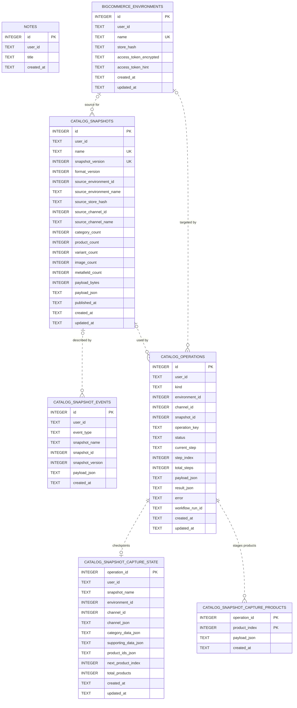
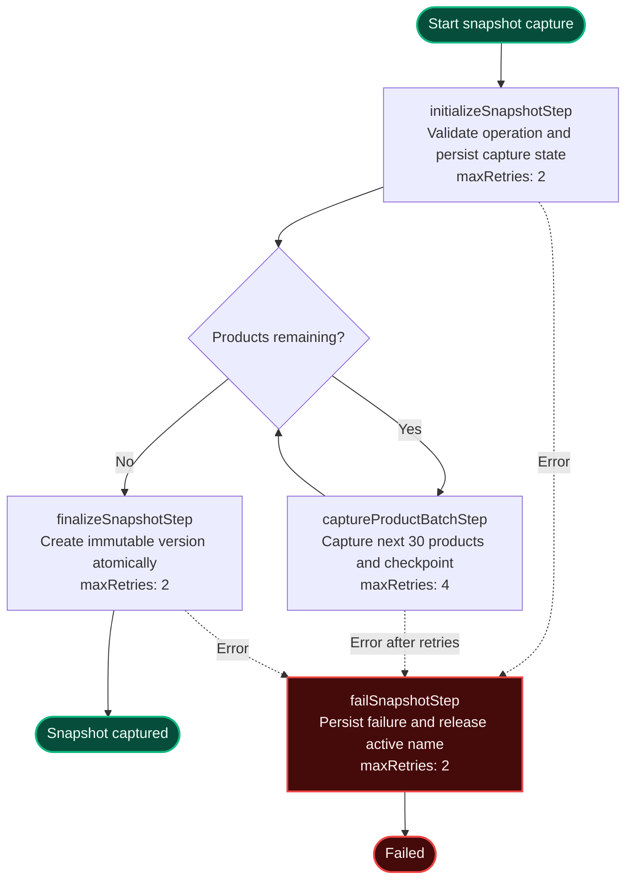
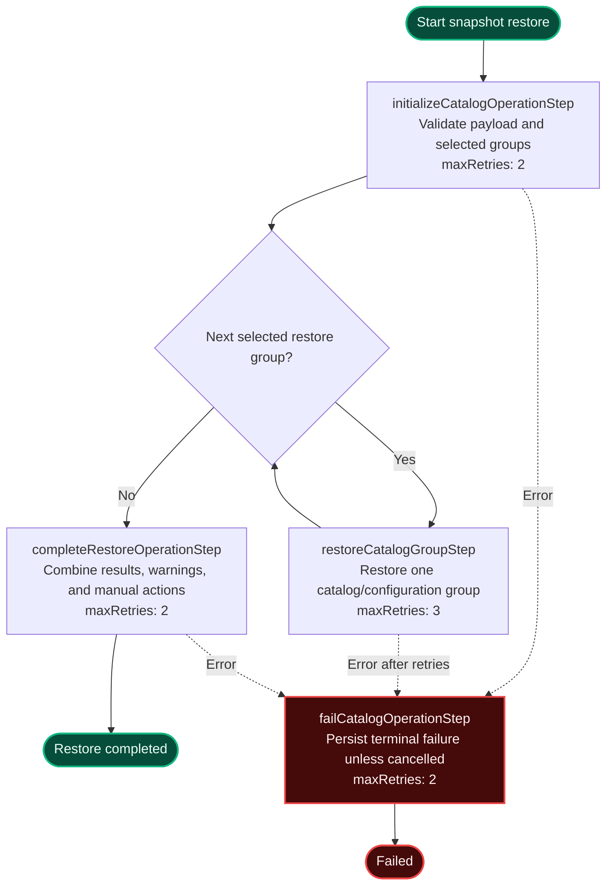
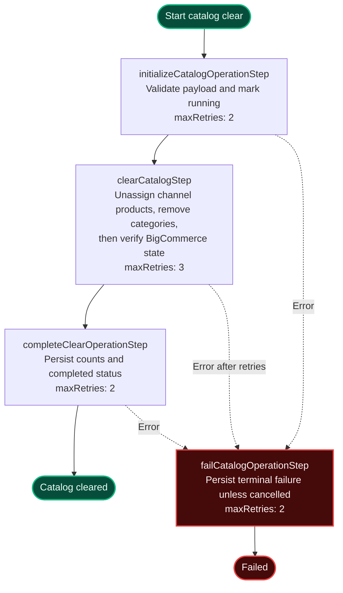

# Implementation Details

This document describes the security model, required BigCommerce permissions, snapshot semantics, configuration portability, durable processing, and catalog restoration behavior of BigCommerce Demo Env.

## Database schema

The application uses Turso/libSQL. Clerk owns user identities externally, so `user_id` columns contain Clerk user IDs and do not reference a local users table. Relationships shown with dashed lines are application-enforced logical references; the schema intentionally defines no SQL foreign-key constraints so immutable snapshot and audit records can survive deletion of their source environment or snapshot.

Important uniqueness rules and indexes are:

- Environment names are case-insensitively unique per user.
- Snapshot `(user_id, name, snapshot_version)` tuples are unique, and only one version per case-insensitive user/name series can be published.
- Only one queued or running operation can exist for a non-null `(user_id, kind, operation_key)` tuple.
- Capture-product rows use the composite primary key `(operation_id, product_index)`.

## Security and tenancy

BigCommerce access tokens are encrypted with AES-256-GCM before storage. The application returns only the final four characters to the Settings UI and binds each encrypted value to its owning Clerk user. Reads, updates, deletes, and Dashboard credential lookups also include the Clerk user ID, so one user cannot access another user's settings. Dashboard API requests run only on the server and are never cached.

Snapshot payloads contain catalog data and public image links, but never BigCommerce access tokens.

## BigCommerce access scopes

For catalog-only Dashboard metrics and snapshot capture, **Products: read-only** and **Channel Settings: read-only** are sufficient. Capturing every optional configuration section also benefits from Sites & Routes, Information & Settings, Themes, Content, the corresponding Shipping/Tax read scopes, and **B2B Edition: read-only**.

Catalog restore needs **Products: modify**; selected configuration sections require their matching modify scopes. Localization translation restore specifically needs **Content: modify** (the `store_content` OAuth scope), and B2B restore needs **B2B Edition: modify**.

Deleted channels are excluded from totals, navigation, and restore destinations. Snapshot creation fails when required catalog data is incomplete, while optional configuration authorization failures are recorded as manifest warnings.

## Snapshot storage, capture, and publication

Snapshot names define case-insensitive, per-user version series; each row is uniquely identified by name and snapshot version, metadata is indexed separately for fast navigation, and no retained payload is overwritten. Publication is opt-in and limited to one version per owner/series; unpublishing immediately removes cross-tenant access.

Product capture resolves BigCommerce channel assignments first, then loads only the assigned product IDs. Reads are serialized per store and use BigCommerce quota/reset headers for proactive throttling and automatic 429 retries.

Configuration capture is best-effort by resource. Missing OAuth scopes, APIs unavailable for a channel type, and unsupported provider configuration are retained as warnings instead of invalidating the catalog snapshot.

## Configuration restoration

Restore starts with Catalog selected and the safe configuration groups opt-in: Storefront settings, Checkout & customer experience, Pricing & currencies, Shipping, Tax, Inventory & locations, B2B Edition, and Localization & presentation.

### Storefront settings

The Storefront settings group resolves inherited global values into effective source values and creates explicit destination-channel overrides for contact display name, address and phone, text/image logo and favicon, SEO and robots.txt, product/category display, catalog preferences, inventory rules, search, status messages, and customer privacy.

The captured contact email remains inspectable but is never restored, preserving the destination store's notification identity. Customer-group selections are remapped by name; empty customer-group responses are treated as no configured groups. Empty textual logos are skipped because BigCommerce rejects them, while image logos and favicons use their dedicated upload endpoints instead of the text-logo settings endpoint. Generated prelaunch passwords and global-only search flags are never submitted.

Captured channel properties, metafields, sites, and routes remain inspect-only and cannot be restored, protecting destination Makeswift integration, URLs, routing, domains, and checkout configuration.

### B2B Edition

Shipping, Tax, Inventory, and B2B Edition are marked store-wide. The B2B group captures permissions, roles, Companies, users, addresses, hierarchy links, shopping lists, quotes, orders, invoices, payments, Company attachment metadata, sales representatives, and extra-field definitions.

Restore additively reconciles custom permissions and roles, Companies, users, addresses, hierarchy links, and shopping lists. Quotes are not recreated because the B2B API automatically submits them to buyers; B2B orders cannot create their underlying BigCommerce orders; invoices, payments, attachment binaries, sales-representative identities, and extra-field definitions remain captured audit data with restore warnings. Creating Companies or users can trigger BigCommerce account or welcome email.

Publishing a snapshot also shares its captured B2B demo data with other authenticated application users, so published versions must contain demo-safe identities and business records only.

Stable resources are reconciled by names and generated IDs; destination domains, SSL ownership, carrier/payment/tax-provider credentials, fulfillment mappings, and other secrets are never copied. Mapping-sensitive resources that cannot be applied safely remain recorded in the immutable manifest and are surfaced as restore warnings.

### Localization and translations

Localization capture records the source channel's locales and its effective default country, falling back to the store default when the channel inherits it. Localization restore writes that country specifically to the destination channel, adds captured locales that are missing without removing unrelated destination locales, respects BigCommerce's five-locale channel limit, and activates the captured default locale after reconciliation.

Product and category translations are mapped independently from Catalog restoration using stable product SKUs/slugs and category paths, so Localization can be restored on its own after the destination catalog already exists.

### Shipping

Shipping restore reuses BigCommerce's immutable global zone, reconciles other zones by name, and creates or updates the captured methods with their rates and enabled state. Newly created methods are assigned to the channel being restored; existing methods retain their current channel assignments and add only that destination channel. Read-only response fields are removed from write payloads, and detailed BigCommerce validation messages are retained in operation warnings.

### Tax

Tax restore maps BigCommerce's immutable default zone to destination zone `1` and restores its editable display settings without sending `shopper_target_settings` or `enabled`. Default-zone status, locations, and customer groups are owned by BigCommerce and cannot be changed; ordinary tax zones retain their captured targeting. Existing destination zone IDs continue to be mapped even if a best-effort metadata update produces a warning, so captured tax rates can still reconcile.

### Currencies and payment visibility

Currency restore creates or enables missing currencies globally in the destination store from the snapshot's captured definitions, including transactional currencies. Because BigCommerce can expose a newly created store currency to channels that inherit global defaults, restore first records every unrelated live channel's currency visibility and reapplies those assignments after the global mutation. The snapshot's enabled and default currencies are then assigned only to the channel being restored. Older snapshots can reconstruct their default currency from catalog currency metadata; secondary currencies still require a captured store definition or prior destination setup.

BigCommerce currently restricts payment-profile channel associations to its authenticated Control Panel service rather than the public store-token APIs used by background restore jobs. A pricing restore therefore records a manual action in channel and snapshot History for the restored currencies, with a direct link to **Payments → Manage Channel Visibility**. Use that action to assign the intended gateway configuration—such as Test Payment Provider—to the destination channel without copying or persisting Control Panel session credentials.

## Durable catalog processing

Large snapshot captures are initialized once, checkpointed in Turso, and processed in retryable 30-product Workflow steps before an atomic finalization transaction creates the immutable snapshot version. Closing the browser, navigating away, an individual Function timeout, or a deployment does not discard completed batches. A capture with no server heartbeat for ten minutes is marked failed instead of remaining permanently active, and its name becomes available for another attempt.

Restore and clear operations also start registered Vercel Workflow runs instead of relying on a browser request or a Next.js `after()` callback. Their Workflow run IDs are stored with the tenant-owned operation row in Turso, allowing the API to reconcile run state after navigation, reload, deployment, or a Function restart. Restore checkpoints the selected catalog/configuration groups as retryable steps; clear safely re-reads the remaining channel assignments and categories when a step is retried. Cancellation stops the Workflow run and updates the same operation row used by the channel, environment, dashboard, snapshot, and History views.

### Snapshot capture Workflow

### Snapshot restore Workflow

### Clear catalog Workflow

The restore and clear paths are two branches of `catalogOperationWorkflow` and therefore share their initialization and failure steps. Cancellation is initiated through the catalog-operation API by cancelling the registered run and persisting `cancelled`; it is run control rather than a `"use step"` function, so it is not shown as a step node above.

Restore is presented as a three-step wizard: choose the snapshot and version plus the destination, select the available restore sections, then review the destination preflight and enter the typed confirmation. On channel pages, Snapshot and Version are separate selectors: selecting a snapshot chooses its newest version, the Version selector contains only that series, and a star identifies its published version. The step header exposes progress and permits returning to completed steps, while the modal footer keeps Cancel, Back, Continue, preflight, and final Restore actions visible independently from scroll position. Changing a prior selection invalidates confirmation and requires a fresh preflight.

The read-only preflight is bound to the exact snapshot version, destination environment/channel, and selected restore groups. It revalidates snapshot access and destination ownership, resolves existing category paths and product SKU/slug matches, counts new records and channel assignments, surfaces captured-resource warnings and store-wide effects, identifies manual payment-visibility work, and blocks ambiguous product matches. The server reruns the same preflight immediately before creating the durable restore operation.

## Catalog restoration behavior

Restoration is cross-store and cross-channel. It maps category hierarchy by URL slug and products by any matching SKU or product slug. Existing matched products keep their attributes, variants, images, metadata, and stock; restore only associates them with the snapshot categories and destination channel.

Missing products are created in full, including mapped brands, tax classes, option/value IDs, variants, images, catalog metadata, aggregate product/variant inventory levels, category links, and channel assignment. Location-specific Inventory API balances and reservations are not captured. Restoration is additive: categories, products, variants, and channel assignments absent from the snapshot are preserved.

## Partial restoration and retries

BigCommerce does not provide a transaction spanning the complete catalog restore. If an API request fails, the destination can be partially updated; the error remains visible in the modal and rerunning the same immutable snapshot continues the deterministic reconciliation. Metafields owned privately by a different API client can still be rejected by BigCommerce.

Review the selected environment/channel carefully and take a fresh snapshot before restoring when you need a manual rollback point.
