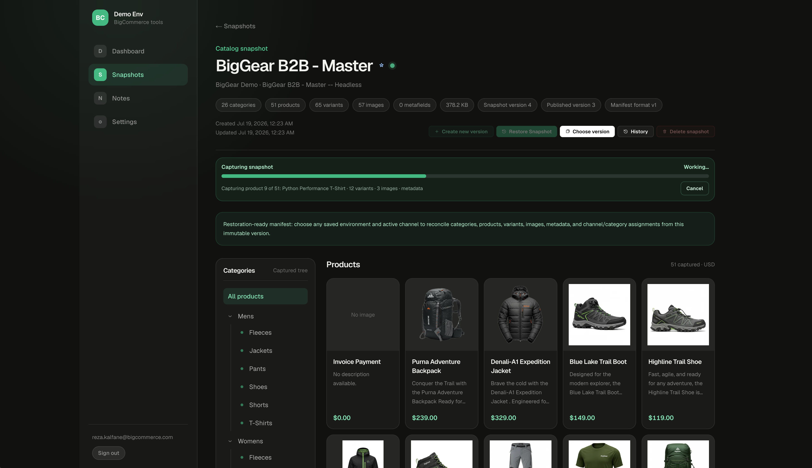

# BigCommerce Demo Environments Manager

A deployable Next.js 16 application with the App Router, Tailwind CSS 4, Turso/libSQL, and Clerk passwordless authentication. After signing in, users get a shared application sidebar with a live BigCommerce Dashboard plus private Snapshots, Notes, and Settings pages. Every database query is scoped to the authenticated Clerk user.



## Application pages

- **Dashboard** shows live channel, category, product, and variant totals for every saved environment in a responsive three-column grid, expanding to four columns on wide screens when the global navigation is collapsed. Environment names link to a tenant-scoped detail page listing each non-deleted channel and its primary storefront URL. Small star controls favorite environments, channels, and snapshot series per user; favorites sort before the remaining alphabetized cards across Dashboard, Settings, channel, and Snapshots lists. Every resource collection includes instant search plus compact card/table view controls, and each signed-in user's display choice—including matching card or compact-table loading skeletons—is restored across sessions and devices per page type rather than per individual environment, channel, or snapshot.
- **Channel catalog** opens from an environment's channel list and shows an expandable category tree beside a responsive product browser with images, names, short descriptions, and calculated prices. Selecting a category filters the browser to products assigned to that category or any of its descendants; local search and card/table controls refine the selected category without another API request. Compact product tables use a fixed percentage layout so the name, description, categories, and price columns fit beside the category tree without desktop horizontal scrolling. Channel actions include modal snapshot capture, selecting any saved snapshot/version for restoration, and clearing category contents plus channel assignments without deleting products. Snapshot capture, restore, and clear run as durable Vercel Workflows with persisted run IDs, retryable work, reload-safe progress, cancellation, rate-limit backoff, and channel-scoped History. Large captures checkpoint both 10-category and 30-product batches in Turso, so worker and local development-server restarts—including loss of the local Workflow run record—resume the latest operation from the last completed batch. The authenticated app shell keeps observing those operations across navigation, removes completed activity indicators without requiring a detail-page visit, and displays 30-second completion, failure, or manual-action popups with a direct link to the affected channel or snapshot. Every result also enters the global notification center and remains there until individually deleted or cleared with **Delete all**.
- **Snapshots** creates named, tenant-owned catalog templates from products assigned to a selected channel and presents captured categories and products with the same tree and grid experience as the live catalog browser.

  - **Index and browsing:** The template index merges every snapshot-name series into one card, showing its latest capture and total version count. Published series appear first; published and private groups are each sorted by name.
  - **Naming and versioning:** The naming form suggests existing series with their latest version and source channel. Reusing a name—or choosing **Create new version**—shows confirmation details before saving an immutable next version and retaining all earlier versions. Owners can rename the complete series by double-clicking its detail-page title; uniqueness is enforced, the change is recorded in History, and viewers of a published version receive the update. **Choose version** browses immutable captures and can delete any unpublished version other than the one currently being viewed. Deleted version numbers are never reused, and publish, unpublish, and deletion events retain their version, source, and catalog details in History.
  - **Publishing and sharing:** One version per series can be published or unpublished. Published snapshots use blue sharing indicators and appear to other authenticated users as read-only templates that identify the publisher by email and expose only the published version. Other users can inspect and restore the published catalog to their own active channels, but cannot create versions, view private versions or History, publish, unpublish, or delete it.
  - **Inspection, comparison, and restoration:** **Inspect settings** loads the selected version's captured channel, site, and store resources on demand, including inspect-only routing data, restorable effective storefront settings, required scopes, raw values, and capture warnings. **Compare versions** performs an authenticated, server-side directional diff between two immutable versions in the same series, summarizing added, removed, changed, and unchanged categories, products, variants, images, metafields, and configuration resources with expandable record-level details. **Restore Snapshot** uses a three-step wizard for destination selection, restore sections, and preflight review. On channel pages, separate Snapshot and Version selectors keep versions scoped to their series and mark published versions. The read-only preflight presents a compact Snapshot → Destination comparison for new, matched, destination-only preserved, and conflicting catalog records; existing and new channel assignments; store-wide selections; warnings; and required manual actions before typed confirmation is enabled. The server repeats the preflight immediately before starting the durable restore Workflow.
  - **Captured manifest:** Every new manifest stores complete catalog records plus best-effort channel and storefront settings, checkout and customer-experience settings, pricing and currencies, shipping, tax, inventory and location definitions, locales and translations, non-secret script metadata, active-theme metadata, and—only for channels explicitly enabled in B2B Edition—a B2B demo-data export.
- **Operations** provides a tenant-scoped ledger of current and previous snapshot captures, restores, catalog clears, version publications/unpublications/deletions, snapshot renames/deletions, and environment additions/deletions. Its compact table supports text, type, status, environment, attention, and date filters plus sorting across identifiers, operation type, status, target, snapshot, progress, timestamps, and duration. Fixed column allocations, truncated long progress labels, and stacked date/time values keep the ledger readable without letting one operation distort the complete table. Double-clicking a row or using its Details action opens a modal with exact progress, results, restore sections, warnings, errors, validated manual actions, Workflow identifiers, and direct links to retained resources. The **Workflows** subpage turns the same tenant-owned ledger into a searchable runtime-debugging view with application and Vercel runtime status, run IDs, stale-heartbeat diagnostics, cancellation and retry controls, direct resource links, and a visual trace. Snapshot traces expand configuration capture into storefront, experience, pricing, shipping, tax, B2B, and localization/inventory macro stages; clear traces distinguish product unassignment, category removal, and final verification. An operation can open its exact workflow directly. The ledger refreshes periodically and more frequently while work is running. Every desktop page has an arrow control that switches between the full sidebar and a full-width icon rail; this single preference is private to the signed-in user and applies throughout the application.
- **Notes** provides a private scratchpad backed by Turso.
- **Settings** manages named BigCommerce environments with a store hash and API access token in searchable card and compact-table layouts. Each environment includes **Test access**, which runs read-only server probes and opens a scope report covering available operations, inferred missing scopes, B2B availability by channel, APIs unsupported by the store/channel type, and write capabilities that still require unverified modify scopes.

## Implementation details

See [`DETAILS.md`](./DETAILS.md) for security and tenancy, required BigCommerce scopes, snapshot semantics, configuration portability, durable processing, and catalog restoration behavior.

## Local development

Node.js 20.19 or newer is required. Clerk credentials are required; the database can use a local SQLite file for development.

```bash
npm install
npx vercel@latest link
npx vercel@latest integration add clerk
npx vercel@latest env pull .env.local --yes
```

Add a stable encryption secret to `.env.local` before saving BigCommerce environments:

```bash
openssl rand -base64 32
```

Store the generated value as `SETTINGS_ENCRYPTION_KEY`. For local compatibility the app can derive a key from `CLERK_SECRET_KEY`, but a dedicated value is recommended and must remain stable so saved tokens remain decryptable after Clerk key rotation.

Configure the Clerk development instance under **User & authentication**:

1. Require email addresses for sign-up and select **Email verification code**.
2. Enable email sign-in with both **Email verification code** and **Email verification link**.
3. For corporate inboxes that inspect links, disable **Require the same device and browser** so the scanner does not cause `client_mismatch`. This improves link reliability but weakens Clerk's protection against an attacker initiating a link flow for somebody else's email address. Prefer email codes when that tradeoff is unacceptable.
4. Do not require profile fields beyond email, and disable required passwords so code-based sign-up can complete without collecting a password. Social strategies can remain enabled in Clerk, but this custom page does not expose them.

Email codes remain the recommended default for corporate Microsoft Outlook and Office 365 inboxes. Their security scanners can follow a login link before the user clicks it. The original page must remain open while a login-link flow is pending so it can complete the session automatically.

Under **Restrictions**, enable the allowlist and add `*@bigcommerce.com` and `*@commerce.com`. The application also checks these exact domains in the browser and on the server, so protected pages remain unavailable to any other Clerk account.

Start the application and open [http://localhost:3000](http://localhost:3000):

```bash
npm run dev
```

After one successful online load, a lightweight service worker caches only a generic offline shell—not authenticated pages, API responses, or catalog data. If the development server stops or restarts, reloading any application URL shows the branded server-unavailable screen, preserves the exact requested path, checks availability every 2.5 seconds, and reloads that same page automatically when Next.js is reachable again. Transient background-operation polling failures remain silent and resume on their next interval.

Without Turso variables, local development creates `local.db` in the project directory. To use Turso, add the Marketplace integration and pull the updated environment:

```bash
npx vercel@latest integration add tursocloud/database
npx vercel@latest env pull .env.local --yes
```

## Deploy to Vercel

Provision both Marketplace integrations before the first deployment:

```bash
npx vercel@latest link
npx vercel@latest integration add clerk
npx vercel@latest integration add tursocloud/database
npx vercel@latest env pull .env.local --yes
npx vercel@latest deploy
```

The `workflow` package and `withWorkflow()` integration automatically provision Vercel Workflow storage, queues, authenticated handlers, retries, and observability during deployment; no additional secret or Marketplace integration is required. Snapshot runs can be inspected from the Vercel project Workflow view or with `npx workflow inspect runs --backend vercel`.

Clerk injects `NEXT_PUBLIC_CLERK_PUBLISHABLE_KEY` and `CLERK_SECRET_KEY`. Turso injects `TURSO_DATABASE_URL` and `TURSO_AUTH_TOKEN`. Apply the Clerk settings from the local-development section to both development and production instances.

For live cross-user snapshot publication updates, create an Ably app and add its server API key as `ABLY_API_KEY` in Development, Preview, and Production. Browsers receive short-lived Clerk-protected, subscribe-only tokens; the API key is never exposed client-side. When configured, Publish and Unpublish actions notify open Snapshots pages immediately and those pages refresh their authoritative data from Turso. Without Ably—or if a realtime event is missed—the page uses a visibility-aware 30-second fallback refresh.

Add `SETTINGS_ENCRYPTION_KEY` to the Development, Preview, and Production environments in Vercel before users save BigCommerce access tokens. Treat it as a permanent secret: changing it prevents existing tokens from being decrypted.

The app creates or migrates the `notes` table and creates the `bigcommerce_environments`, `catalog_snapshots`, `catalog_snapshot_events`, `application_events`, `catalog_operations`, `favorites`, `collection_view_preferences`, and snapshot-capture staging tables on the first authenticated request. All application queries use tenant-aware indexes and user-scoped predicates. Snapshot events preserve version lifecycle records, application events preserve safe environment and whole-snapshot deletion audit metadata, favorite keys preserve each user's preferred ordering without exposing resources across tenants, collection preferences retain card/table and shared-snapshot visibility per page type plus one global sidebar-width choice per user, and operation rows persist background status, Workflow run IDs, progress, results, warnings, and errors. Notes created before authentication was added are preserved with no owner and remain hidden until an explicit ownership migration assigns them.

For a production deployment after the initial preview is verified:

```bash
npx vercel@latest deploy --prod
```

## Useful commands

```bash
npm run dev     # start the local development server
npm run lint    # run ESLint
npm run build   # create a production build
npm run start   # serve the production build
```

## Project records

- [`DETAILS.md`](./DETAILS.md) documents security, snapshot, configuration, and restoration behavior.
- [`CHANGELOG.md`](./CHANGELOG.md) records commits and merges in reverse chronological order.
- [`HISTORY.md`](./HISTORY.md) records user prompts and implementation summaries in reverse chronological order.
